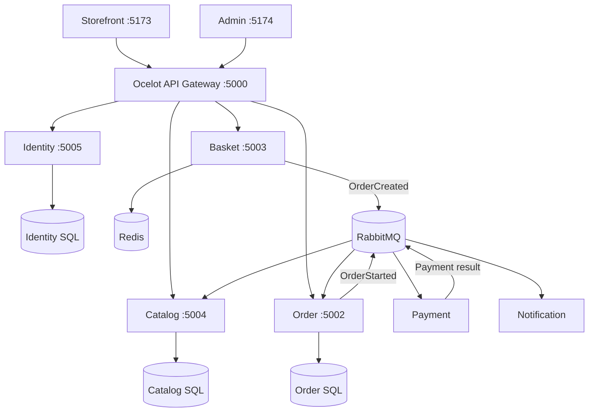

# Velora

Velora is a production-minded e-commerce platform built on the original
SellingBuddy microservice solution. It includes a customer storefront, a
permission-aware back office, and an asynchronous checkout flow backed by real
services and data stores.

There is no mock API layer in the application. Local development uses SQL
Server, Redis, RabbitMQ and Consul; the full stack can also run with Docker
Compose or on Docker Desktop Kubernetes.

> [!IMPORTANT]
> Velora is ready for local development and sandbox demonstrations, not for
> real-money production sales. Production payment mode fails closed until a
> real PSP adapter, signed webhooks, refunds and reconciliation are implemented.
> See [Production readiness](#production-readiness) for the remaining gates.

## Highlights

- Two independently deployable React applications: a customer storefront and an
  MUI-based admin panel.
- Authentication, rotating refresh tokens, roles, fine-grained permissions,
  address management and customer-owned resources.
- Product search, facets, categories, brands, variants, reviews, wishlists,
  coupons, campaigns, media uploads and inventory management.
- Idempotent checkout with server-authoritative pricing, durable stock
  reservations, transactional outboxes and service-specific dead-letter queues.
- RabbitMQ as the active event transport, with Azure Service Bus available as an
  explicit opt-in transport.
- Shared RFC 9457 error responses, health probes, correlation IDs and
  OpenTelemetry instrumentation.
- Docker Compose, Helm and Docker Desktop Kubernetes workflows with automated
  verification scripts.
- A deterministic demo catalogue with 47 products, 8 brands, 5 root categories,
  23 subcategories, 6 campaigns and 5 coupons.

The latest documented live-stack verification was run on 24 November 2026
against Docker Compose and Docker Desktop Kubernetes. It includes the complete
HTTP flow, the RabbitMQ saga, concurrent stock contention and broker recovery;
see [the live test report](docs/CANLI-TEST-SONUCLARI-2026-11-24.md).

## Architecture



The gateway uses Consul service discovery during local `dotnet run`
development. Docker Compose and Kubernetes use platform DNS and the generated
`ocelot.k8s.json` route table instead.

### Services

| Component | Responsibility | Data store |
|---|---|---|
| Identity | Users, roles, permissions, sessions and addresses | SQL Server |
| Catalog | Products, taxonomy, media, promotions, reviews and inventory | SQL Server + media volume |
| Basket | Basket, wishlist, coupon application and checkout acceptance | Redis |
| Order | Order aggregate, status state machine, analytics and saga coordination | SQL Server |
| Payment | Sandbox payment step; production is disabled until a PSP is integrated | — |
| Notification | Event-driven notification handlers; currently writes to logs | — |
| API Gateway | Routing, authentication pre-checks, rate limits and timeouts | — |

### Checkout flow

1. Basket asks Catalog for an authoritative quote and protects the request with
   an idempotency key and payload hash.
2. Basket publishes `OrderCreated` and returns `202 Accepted`.
3. Order creates the aggregate while Catalog reserves stock transactionally.
4. A successful reservation starts Payment; a rejected reservation cancels the
   order before payment.
5. Payment success marks the order paid and consumes the reservation. Payment
   failure cancels the order and releases the reservation.
6. Notification consumes payment, order-status and low-stock events.

RabbitMQ uses one durable queue per service/event pair and a service-specific
dead-letter exchange. Order and Catalog persist outgoing integration events in
transactional outboxes. The complete event matrix is exercised by
`scripts/verify-eventbus.py`.

## Technology

| Area | Stack |
|---|---|
| Backend | .NET 10, ASP.NET Core, EF Core, MediatR |
| Gateway and discovery | Ocelot, Consul |
| Messaging | RabbitMQ; optional Azure Service Bus |
| Data | SQL Server 2022, Redis 7 |
| Frontend | React 18, TypeScript, Vite 6, pnpm workspaces |
| Storefront | Redux Toolkit/RTK Query, Tailwind CSS, Framer Motion, i18next |
| Admin | MUI, MUI Data Grid, ECharts, Redux Toolkit/RTK Query |
| Validation and tests | Zod, Vitest, Testing Library, Playwright, MSTest |
| Operations | Docker Compose, Helm, Kubernetes, OpenTelemetry, GitHub Actions |

## Requirements

- [.NET SDK 10.0.301](global.json)
- Node.js 20.11 or newer
- pnpm 9.12 (`corepack enable` can install the pinned package manager)
- Docker Desktop with Docker Compose
- Windows PowerShell 5.1 or PowerShell 7+ for the provided Windows scripts
- Python 3 for the live verification scripts
- Optional: `kubectl` and Helm for Kubernetes

## Quick start with Docker Compose

This is the shortest way to run the complete stack. For hot reload and debugger
support, use [local development](#local-development) instead.

### 1. Create local configuration

```powershell
Copy-Item .env.example .env
notepad .env
```

Generate your own values; do not copy secrets from documentation or commit
`.env`. At minimum, fill the required signing, SQL, Redis and RabbitMQ values,
plus the optional bootstrap-admin credentials.

For a local full-stack run, use browser-reachable origins:

```dotenv
API_PUBLIC_URL=http://localhost:5000
MEDIA_PUBLIC_URL=http://localhost:5000
STOREFRONT_ORIGIN=http://localhost:8080
ADMIN_ORIGIN=http://localhost:8081

# Local sandbox checkout only; never use these flags for real payments.
PAYMENT_MODE=Sandbox
PAYMENT_ALLOW_SANDBOX=true
```

If `STOREFRONT_PORT` or `ADMIN_PORT` is changed, update the matching origin as
well. `MEDIA_PUBLIC_URL` must be an origin without `/media`; media paths already
include that prefix.

### 2. Build and start

```powershell
docker compose -f docker-compose.prod.yml up -d --build
docker compose -f docker-compose.prod.yml ps
```

The first build creates nine images and can take several minutes. Wait for the
data services to become healthy before judging the application services.

| Surface | Default URL | Credentials |
|---|---|---|
| Storefront | http://localhost:8080 | Register a customer account |
| Admin | http://localhost:8081 | `SEED_ADMIN_EMAIL` / `SEED_ADMIN_PASSWORD` from `.env` |
| API Gateway | http://localhost:5000 | — |
| RabbitMQ UI | http://127.0.0.1:15673 | `RABBITMQ_USER` / `RABBITMQ_PASSWORD` from `.env` |

No admin is created when the seed credentials are blank. Seed credentials are
only a bootstrap mechanism and should be changed after first use.

Useful lifecycle commands:

```powershell
docker compose -f docker-compose.prod.yml logs -f gateway
docker compose -f docker-compose.prod.yml up -d --no-deps --force-recreate storefront admin
docker compose -f docker-compose.prod.yml down
```

The frontend containers receive their API, media and site origins at startup
through `/config.js` and the generated Content Security Policy. Changing those
values requires recreating the frontend containers, not rebuilding their
images. The `VITE_*` build arguments remain fallbacks for non-container builds.

## Local development

Local development runs only the infrastructure in Docker. Backend services run
from the .NET SDK, and both frontends run from Vite.

### 1. Prepare the environment

```powershell
Copy-Item .env.example .env
# Fill .env, then load it into every shell used for the backend.
. .\scripts\load-env.ps1
```

Keep these local values aligned:

- `SQL_SA_PASSWORD` = `VELORA_SQL_PASSWORD`
- `RABBITMQ_USER` = `EventBus__UserName` = `VELORA_RABBITMQ_USER`
- `RABBITMQ_PASSWORD` = `EventBus__Password` = `VELORA_RABBITMQ_PASSWORD`
- `SEED_ADMIN_PASSWORD` = `VELORA_SEED_ADMIN_PASSWORD` =
  `VELORA_ADMIN_PASSWORD` when the admin and verification scripts use the same
  account

The leading dot in `. .\scripts\load-env.ps1` matters: it loads the variables
into the current PowerShell session so child processes inherit them.

### 2. Start infrastructure

```powershell
.\scripts\start-infrastructure.ps1
```

| Dependency | Local endpoint |
|---|---|
| SQL Server | `localhost,1444` |
| Redis | `localhost:6379` |
| RabbitMQ | `localhost:5672` · UI: http://localhost:15672 |
| Consul | http://localhost:8500 |

### 3. Start backend services

Start each command in its own PowerShell window after loading `.env`. Start the
gateway last so the other APIs have time to register with Consul.

```powershell
dotnet run --project SellingBuddy/src/Services/IdentityService/IdentityService.Api --urls http://localhost:5005
dotnet run --project SellingBuddy/src/Services/CatalogService/CatalogService.Api --urls http://localhost:5004
dotnet run --project SellingBuddy/src/Services/BasketService/BasketService.Api --urls http://localhost:5003
dotnet run --project SellingBuddy/src/Services/OrderService/OrderService.Api --urls http://localhost:5002
dotnet run --project SellingBuddy/src/Services/PaymentService/PaymentService.Api --urls http://localhost:5001
dotnet run --project SellingBuddy/src/Services/NotificationService/NotificationService --urls http://localhost:5006
dotnet run --project SellingBuddy/src/ApiGateways/WebApiGateway/Web.ApiGateway --urls http://localhost:5000
```

Development Swagger endpoints are available on the HTTP APIs, for example
http://localhost:5005/swagger and http://localhost:5004/swagger. Payment and
Notification work primarily through the event bus; their HTTP surface is for
health checks and, for Payment, development Swagger.

### 4. Start the frontends

```powershell
Set-Location velora
pnpm install --frozen-lockfile
pnpm dev
```

- Storefront: http://localhost:5173
- Admin: http://localhost:5174
- Admin login: `admin@velora.com` and `VELORA_SEED_ADMIN_PASSWORD`, unless the
  seed email was overridden

The detailed Turkish walkthrough covers manual startup, Docker Compose,
Kubernetes and common setup errors:
[docs/LOKAL-CALISTIRMA.md](docs/LOKAL-CALISTIRMA.md).

## Demo data and media

Catalog seeding is deterministic and idempotent. A new database receives:

- 47 products across Kadın, Erkek, Aksesuar, Seyahat and Ofis
- 23 subcategories and 8 Velora house brands
- Product variants, reviews, stock and sales data
- 6 campaigns
- 5 coupons: `VELORA10`, `SEYAHAT15`, `KARGO`, `HOSGELDIN250` and `OFIS20`

Curated catalogue images live in
`SellingBuddy/src/Services/CatalogService/CatalogService.Api/wwwroot/media/catalog/`
and are served through `/media/catalog/*`. The seeder upgrades retired
`picsum.photos` placeholders in existing databases without changing media
uploaded through the admin panel.

The storefront keeps presentation copies in
`velora/apps/storefront/public/showcase/`. Its editorial home-page content is a
graceful fallback while Catalog is unavailable or not yet seeded; API data wins
as soon as it is present.

## API overview

All browser clients call the API Gateway. The main route groups are:

| Route group | Purpose |
|---|---|
| `/auth`, `/addresses` | Authentication, account and address book |
| `/products`, `/categories`, `/brands`, `/campaigns` | Public catalogue and discovery |
| `/basket`, `/basket/wishlist`, `/coupons/validate` | Customer basket, wishlist and discounts |
| `/orders` | Customer order history, details and cancellation |
| `/admin/*` | Permission-gated catalogue, promotion, order and analytics operations |
| `/users`, `/roles` | Permission-gated staff administration |
| `/media/*` | Catalogue and uploaded media |

Public storefront reads are anonymous. Customer routes require a valid customer
token, while back-office operations enforce API-side permission policies such
as `products.write`, `orders.read` and `analytics.read`. Hiding a control in the
admin UI is never the authorization boundary.

## Testing and verification

### Frontend

```powershell
Set-Location velora
pnpm lint
pnpm typecheck
pnpm test
pnpm build
pnpm test:e2e     # requires the running backend
```

The current unit-test inventory is 127 tests: 80 in `packages/shared`, 30 in
the storefront and 17 in the admin application.

### Backend and live stack

```powershell
dotnet restore SellingBuddy.sln
dotnet build SellingBuddy.sln -c Release --no-restore
dotnet test SellingBuddy.sln -c Release --no-build

# The following commands require a running stack and loaded .env values.
python scripts/verify-stack.py       # 61 HTTP and business-flow checks
python scripts/verify-eventbus.py    # 34 topology and message-flow checks
python scripts/verify-live-load.py   # stock contention, queues and latency percentiles
python scripts/verify-chart.py       # 54 Helm-chart invariants; no running stack needed
```

RabbitMQ and Azure Service Bus round-trip tests skip when their broker is not
configured. In CI, RabbitMQ is provisioned so its transport tests execute
instead of producing a misleading brokerless green run.

## Configuration and secrets

`.env` is ignored by Git and must stay uncommitted. `.env.example` documents the
supported variables but intentionally contains no usable secret.

.NET configuration follows the normal precedence rules: `appsettings.json`,
environment-specific settings, then environment variables. Nested keys use
double underscores, so `AuthConfig:Secret` maps to `AuthConfig__Secret`.

Outside `Development`, services fail at startup when signing keys, connection
strings or other required values are absent. Development keeps a non-production
JWT key but still requires local SQL and RabbitMQ credentials from the loaded
environment.

RabbitMQ is the repository default and the currently documented runtime:

```dotenv
EVENTBUS_TYPE=RabbitMQ
EVENTBUS_TOPIC=SellingBuddyEventBus
```

Azure Service Bus is opt-in. It requires
`EVENTBUS_TYPE=AzureServiceBus` and a valid
`EventBus__ConnectionString`; services refuse to start if Azure is selected
without one. The helper scripts intentionally do not delete Azure resources:

```powershell
.\scripts\use-azure-eventbus.ps1
.\scripts\use-rabbitmq-eventbus.ps1
```

## Security model

- Passwords use PBKDF2-HMAC-SHA256 with per-user salts and constant-time
  comparison.
- Access tokens expire after 60 minutes; refresh tokens rotate, are stored
  hashed, and detect family reuse.
- Repeated login failures trigger account lockout and auth endpoints are rate
  limited.
- Customer ownership is derived from the authenticated token, never trusted
  from request-body user IDs.
- PAN, CVV and card-expiry fields are absent from the active domain, database
  and event contracts; only an opaque payment-provider reference travels.
- Media uploads enforce type and size allow-lists, generated filenames and path
  traversal guards.
- Frontend containers run as non-root and generate CSP plus standard security
  headers at startup.
- CI runs build/test gates, secret scanning, dependency/file-system scanning,
  SBOM generation and container checks.

Browser sessions currently use separate `localStorage` keys for Storefront and
Admin. This prevents cross-application session reuse but remains an XSS-sensitive
storage model; a same-site BFF/HttpOnly-cookie design is a future hardening item.

## Deployment

The repository supports three deployment paths:

| Path | Intended use | Entry point |
|---|---|---|
| SDK + Vite | Daily development and debugging | This README / local guide |
| Docker Compose | Complete self-contained stack | `docker-compose.prod.yml` |
| Helm on Kubernetes | Docker Desktop local cluster and environment-specific manifests | `deploy/charts/velora` |

For local Kubernetes:

```powershell
. .\scripts\load-env.ps1
.\scripts\build-local-images.ps1
.\scripts\velora-k8s.ps1 up
.\scripts\velora-k8s.ps1 open
```

Default Kubernetes endpoints are Storefront `:30080`, Admin `:30081` and API
Gateway `:30000`. Full instructions are in [deploy/README.md](deploy/README.md).

The Helm chart includes environment values, migration Jobs, health probes,
ServiceAccounts, HPA/PDB options and NetworkPolicies. Argo CD is not configured
yet; deployment currently uses `helm upgrade` through the provided tooling.

### Production notes

- Terminate TLS at an ingress or reverse proxy and keep data services private.
- Use managed SQL, Redis, broker, object storage and a real secret store rather
  than the self-contained development dependencies.
- Storefront/Admin origins are also the backend CORS allow-list and must exactly
  match the browser origins.
- Frontend runtime URL changes require container recreation; code changes require
  rebuilding only the affected images.
- Database migrations run on service startup in local development. Kubernetes
  disables that behavior and gates rollout with dedicated migration Jobs.
- Uploaded Catalog media currently uses a persistent volume and keeps Catalog at
  one replica; move media to object storage before horizontal scaling.

## Production readiness

The local sandbox purchase flow is implemented and verified, but the following
items remain release gates:

- Real PSP integration, signed webhooks, refunds, cancellation and settlement
  reconciliation
- A durable acceptance boundary for Basket checkout and a common transactional
  inbox for every consumer
- Production TLS, vault-backed secret rotation, managed data services and
  backup/restore drills
- Object storage and content processing for uploaded media
- A real email/SMS provider with delivery tracking
- External telemetry backend, dashboards, alerts and approved SLO/load targets
- MFA/account recovery, formal audit trails and production authorization review
- Versioned API contracts and a staged migration/rollback exercise

The detailed, evidence-linked status matrix is maintained in
[docs/URETIME-HAZIRLIK-DURUMU.md](docs/URETIME-HAZIRLIK-DURUMU.md).

## Repository layout

```text
microservice_project/
├── SellingBuddy/                 # .NET solution
│   ├── src/ApiGateways/          # Ocelot gateway
│   ├── src/BuildingBlocks/       # shared security, errors, telemetry and event bus
│   ├── src/Services/             # Identity, Catalog, Basket, Order, Payment, Notification
│   └── tests/                    # backend tests
├── velora/                       # pnpm workspace
│   ├── apps/storefront/          # customer application
│   ├── apps/admin/               # back office
│   └── packages/shared/          # API client, schemas, types, i18n and utilities
├── deploy/                       # Helm chart and local Kubernetes infrastructure
├── docs/                         # operations, verification and readiness documents
├── scripts/                      # start, build, deploy and verification helpers
├── tools/Velora.AzureObserver/   # Azure Service Bus observation helper
├── docker-compose.infrastructure.yml
├── docker-compose.prod.yml
├── docker-compose.ci.yml
├── .env.example
└── SellingBuddy.sln
```

Each service and frontend owns its Dockerfile. All images use the repository root
as build context so shared projects and workspace packages remain available.

## Troubleshooting

### `VELORA_SQL_PASSWORD tanimli degil`

Load `.env` into the current shell, including the leading dot:

```powershell
. .\scripts\load-env.ps1
```

### RabbitMQ rejects the configured credentials

RabbitMQ applies `RABBITMQ_DEFAULT_USER` and `RABBITMQ_DEFAULT_PASS` only when
its data volume is first created. If credentials changed after initial startup,
either restore the original values or recreate the development volume. The
following command deletes local broker, Redis and SQL data:

```powershell
docker compose -f docker-compose.infrastructure.yml down -v
```

### Gateway returns `502` or `ServicesAreEmptyError`

Open http://localhost:8500 and confirm Identity, Catalog, Basket and Order have
passing health checks. During SDK development, start the gateway last and make
sure Consul can reach the host address used by each registration.

### Orders stay `Submitted`

Confirm Payment is running and `PaymentService.OrderStarted` has a live consumer
in RabbitMQ. For a local full-Compose checkout, both `PAYMENT_MODE=Sandbox` and
`PAYMENT_ALLOW_SANDBOX=true` must be set explicitly.

### Product images return 404

`MEDIA_PUBLIC_URL` must be a bare origin such as `http://localhost:5000`, not
`http://localhost:5000/media`. For an older `catalog-media` volume, preserve
operator uploads and copy only missing curated assets from a current Catalog
image; do not delete the volume blindly.

## Documentation

| Document | Purpose |
|---|---|
| [Local setup](docs/LOKAL-CALISTIRMA.md) | Step-by-step SDK, Compose and Kubernetes startup |
| [Command reference](docs/CALISTIRMA-KOMUTLARI.md) | Short copy/paste command list |
| [Kubernetes guide](deploy/README.md) | Helm structure, local cluster and operations |
| [Live test results](docs/CANLI-TEST-SONUCLARI-2026-11-24.md) | Latest recorded runtime evidence |
| [Production readiness](docs/URETIME-HAZIRLIK-DURUMU.md) | P0/P1/P2 gaps and evidence |
| [Legacy structure analysis](PROJECT_STRUCTURE.md) | Pre-Velora SellingBuddy baseline; not the current architecture source |
